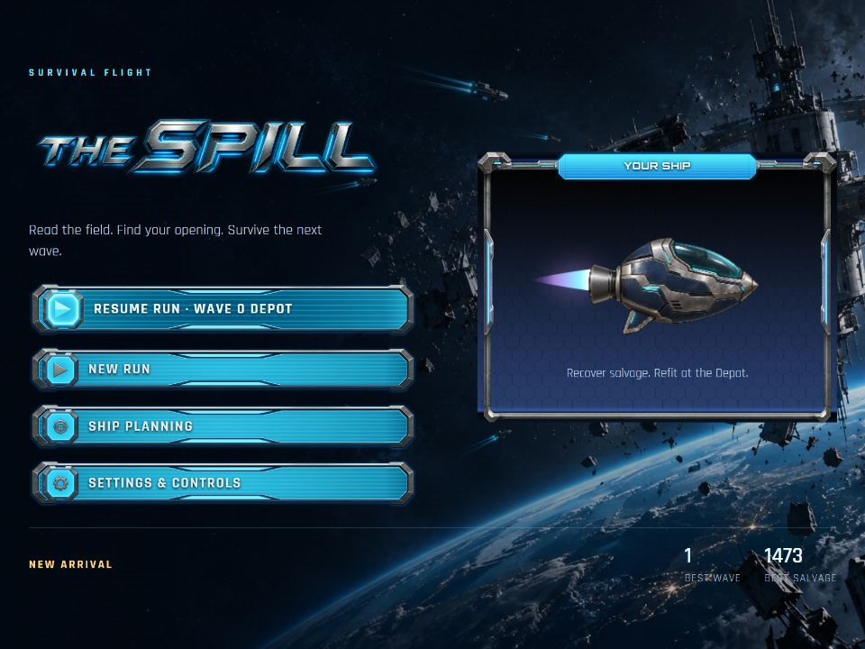
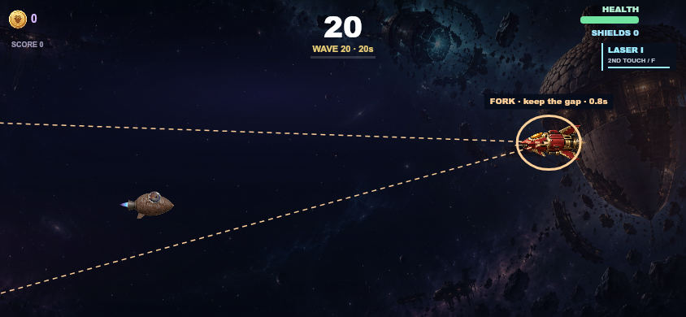
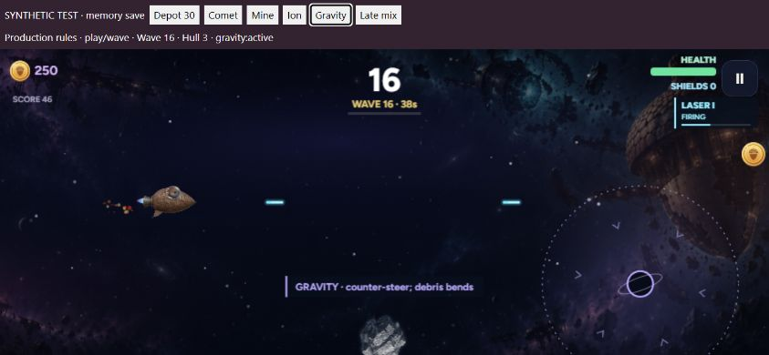
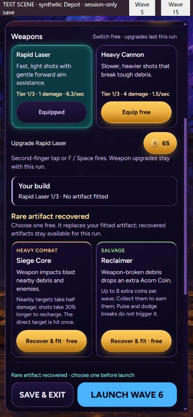
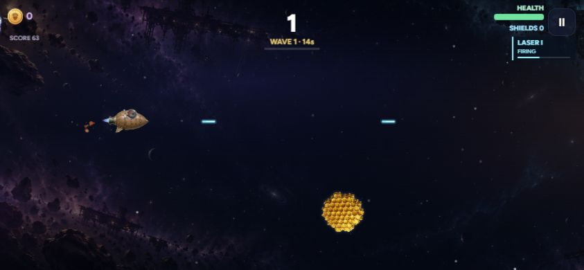
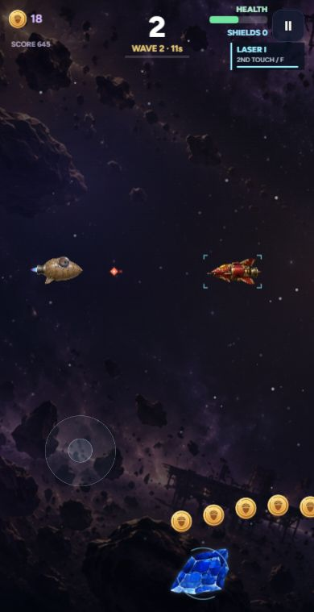
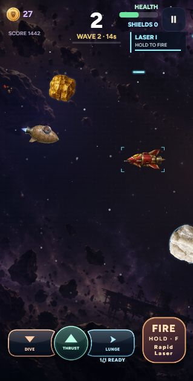

# Browser validation — 2026-10-29

## The Spill identity — 2026-10-30

`npm run check` passes TypeScript, clean build, asset integrity and **28 test files** on existing Node24.19.0. `git diff --check` passes; there is no separate lint script. Docker's Linux engine remains unavailable, so existing local tooling was used without installing host packages. The original 125 assets and two combat sprites remain byte-identical. The 23 new identity files total **2,084,507 bytes**; license, exact generation/edit prompts, original hull reference and source hashes are recorded separately.

The production renderer checks eight portrait/landscape HUD frames with the actual shipped fonts and art, safe text bounds, a clear central flight lane, and unchanged gameplay state. Ship checks cover all 15 system-axis tiers, original attachment registration, no dependence on the old pilot, and the retained illumination setting. A 12-frame ship sheet was inspected. Another 36 cases cover all six launch lessons during countdown/GO at 568x320, 667x320 and 844x390 with a safe-area inset. Existing input, save, economy, trial isolation, encounter, hazard and ship-render regressions pass. The pinned shared-content hash was explicitly updated for the reviewed currency text rename; numeric rules were unchanged.

Actual browser review covered 320x480, 390x844, 568x320, 844x390 and 960x720 layouts. Home, settings, controls/guide, briefing, opening Depot, upgraded trial Depot, locked/equipped/unaffordable choices, trial selectors, launch, pause/resume and saved-run confirmation were exercised before trial navigation was withheld. Long panels scroll without horizontal overflow, game buttons retain a minimum 44px height, confirmation focuses the safe action, and Help disables its dependent prompt switch. Browser review found and fixed compressed short-portrait rows, minimum-width landscape overflow, the Practice badge covering shields, Pause overlapping the hull plate and the countdown covering a lesson. Short-landscape pause/result actions now stay reachable at the bottom. Console errors/warnings were empty.

Comparing the actual supplied examples exposed the missing ship nameplate/backing and stretched borders. Panels now assemble the separate honeycomb surface, metal frame and cyan title plate; buttons and frames use proportional slices. The fixed title remains outside the inset scrolling viewport. At 390x844, Settings content scrolled by 116.6px while its title stayed at y20 and content stayed within y62–806. At 320x480 the Ship Planning title wraps inside its plate without horizontal overflow. Pause and result actions remain reachable at 568x320.

The run-debrief screenshot uses an explicitly labeled **memory-only sample-result fixture**, not a naturally completed 12-wave run. Its restart action and portrait/landscape layouts were checked; the fixture was removed from `dist/` and its tab closed. The earlier Flight HUD proof shows the retained trial renderer. The owner's later menu simplification removes Flight Trials from player navigation and combines Settings with Controls; the trial engine remains covered through the existing isolated test harness, without a production shortcut. The browser viewport override was reset and the normal menu restored.

The final combined page was checked in the browser at 320x480 and 390x844. Its expandable control/field guide remains open across navigation; opening and closing Depot help preserved the actual 1,550.9px scroll position and returned focus to the originating button. The background disclosure is removed from tab order while the modal is open and restored afterward. Content scroll/client widths match (270px narrow, 340px portrait). At 568x320 the four saved-run menu buttons retain 44px heights and the menu has no horizontal overflow. Final screenshots show the simplified menu and normal opening Depot. After the full 28-file pass, the last modal scroll/focus fix was rebuilt and typechecked, then all four affected host suites passed again. Browser console errors/warnings remained empty.

Physical-phone touch feel, audio, sustained performance and owner visual acceptance remain unverified. This pass changes presentation; it does not revalidate long-run balance or select a 3D engine. Publication requires the owner's PR merge approval.

[Phone menu](images/identity-home-portrait.jpg) · [Depot](images/identity-depot-landscape.jpg) · [Settings and Controls](images/identity-settings-portrait.jpg) · [Earlier trial Flight HUD](images/identity-flight-portrait.jpg) · [Sample result fixture](images/identity-results-fixture.jpg) · [Production-rendered upgrade sheet](images/identity-ship-tiers.png)

## Remaining playable package — 2026-10-29

Production source passes TypeScript, clean build, unchanged asset provenance and the full test runner on existing Node24.19.0. The final expanded runner passes **27 test files**. No separate lint script exists; `git diff --check` passes. Docker's Linux engine is unavailable locally; no host packages, runtime dependencies or external art were installed. The 125 upstream assets and two existing generated sprites retain their hashes.

New checks include 14 environmental expansion cases, seven career/loadout cases, ten expedition/climax cases and eight real swept-shot/Siege cases around Warden shield transitions. Host tests exercise actual trial entry, loadout selection, fire, pause, death, completion, retry, end, resume, and both full five-wave route bonuses. The real save and stored JSON remain unchanged through practice, with no score submission or career banking. Legacy checkpoints migrate; malformed IDs/live hazards/unsettled risk blocks and practice checkpoints are rejected.

The scheduling tests cover the previous 192 waves plus **64 full flare/wreck waves** and **24 climax waves**, across seeds and narrow/wide viewports. Those observers use invulnerability to keep the scheduling test running and do not prove natural survival. Separate **192 stock-ship flare/wreck paths** and **16 stock Warden counterplay scenarios** use real steering/projectiles with no immunity, shields, firing or upgrades and take zero hits. They establish the tested escape routes, not universal late-wave balance.

Review fixed wreck-body contact after an earlier same-frame break, late fractures losing their warning/lifetime, gravity pulling enemies back to their home position each tick, six-family selection bias, Warden forks closing their promised gap near edges, and shield transitions using the end-of-tick rather than impact-time state. Reward, chain-fuse, weak-point, cover-loss, rotation and cleanup regressions cover those changes. The old event-only lane fixture now isolates the pre-climax event behavior at equivalent debris tuning; new full-wave tests cover the intentionally changed fifth-wave second act.

Render checks include **36 hazard warning/active frames**, **six additional full-scene cover-loss/fragment frames**, **24 isolated cover/fragment frames**, **15 Warden frames**, and existing ship/combat/build frames. They verify authority geometry, frozen paths, warning visibility, paint-only behavior, reduced motion and portrait/landscape bounds. Flare/wreck full scenes use actual production admission and activation geometry. Representative images below are explicitly **synthetic production-render scenes**, not browser screenshots or natural progression to those waves.

[Solar-cover render](images/evaluation-flare.png) · [Wreck weak-point render](images/evaluation-wreck.png)

Actual browser checks used the shipped **Flight Trials** menu, not a hidden test page. Portrait 390×844 and landscape 844×390 Depots had matching scroll/client widths of 359/359 and 669/669. Trial selection, heavy-build solar launch, Bulwark/Focus choices, a Patrol launch, rotation to **PRACTICE PAUSED · WAVE 6**, Retry back to its Depot, and End back to unchanged best-wave/salvage displays were verified. Console warnings/errors were empty. Browser screenshot capture failed in this session, so full browser visual acceptance is **unverified**; separate render images and DOM measurements do not replace it.

Physical phone feel, two-finger ergonomics, audio, sustained frame rate, natural long-run difficulty/economy and the decision to move into 3D remain for owner evaluation. The owner expressly said nothing new had been validated yet. See [EVALUATION.md](EVALUATION.md) for the short trial sequence and the limits of the 2D-to-3D mapping. This work is delivered through a PR; no merge or live deployment is authorized here.

## Phase 3 hazards — 2026-10-30

Final `npm run check` passes typecheck, clean build, asset provenance and **20 test files** on existing Node24.19.0. Docker's Linux engine remains unavailable; no packages or runtime dependencies were installed. `git diff --check` passes; there is no separate lint script. The original 125 asset hashes and two existing generated sprites are unchanged.

Nineteen hazard rule cases cover the four lessons, deterministic endless plans, frozen harmless warnings, shared enemy/debris pressure, visible-rock preservation, stock-ship escape, gravity force limits and exact curved-debris prediction, common refuges, moving-well envelopes, swept contacts, true 16-pixel ship bounds, weapon/Pulse/cover/reward behavior, mine fuse escape, shifting ion bands, legacy/malformed saves and cleanup. Earlier-shot versus earlier-comet/mine-contact cases verify both orderings inside a simulation tick. Review found and fixed the previous oversized hazard hitbox, contact-before-counterfire ordering, and a moving well crossing its announced refuge. These are regressions against observed failures, not only metadata assertions.

The scheduling suite ran **192 complete wave simulations** across 320×760, 390×844, 844×390 and 1280×720, waves 4/7/11/16/31/41, and eight seeds. It used stock systems with an invulnerability observer to keep the scheduler running: at least two hazards were admitted in each run, maximum concurrency was two, and 48 runs included real overlapping pairs. These runs prove scheduling coverage, not survival balance. Separate stock-hull tests verify the tested escape routes and three advanced ion pulses. The original exact modifier lesson-order assertions are intentionally superseded: new hazard lessons and incompatible force/visibility combinations now suppress old modifiers, while availability and early 3/6/8 lessons remain checked.

The production host suite verifies the shared five-wave forecast, field guide, unchanged controls, RNG-neutral reading, Depot scrolling, saves/legacy resume and pause/rotation of frozen warning paths. Twenty-four production hazard frames plus Blackout and a bent-debris cue frame verify warning/active geometry, portrait/landscape bounds, paint-only state, reduced motion and visible cues. Nine hint-visibility assertions cover the browser-discovered overlap with a gravity core: the reminder now hides when it would obscure the ship or live danger geometry. Existing combat, artifacts, gesture, storage, progression and 192 ship-render checks continue to pass.

Browser checks followed the normal home/briefing/free-upgrade/launch/fire/pause path. A disposable **labeled synthetic fixture**, using production host/rules and memory-only saves, exercised gravity movement/firing and the wave-30 Depot forecast. Expanded forecast scroll/client widths matched at 359/359 in portrait and 669/669 in landscape; its launch footer remained reachable. Browser console warnings/errors were empty. The fixture is excluded from the repository and removed from final generated output; it is not a shipped wave selector or debug door.

[Expanded narrow Depot forecast fixture](images/hazard-forecast-fixture.jpg)

Physical phone ergonomics, audio, sustained performance, and natural late-run balance remain unverified. This comparison uses published game design sources, not measured competitor playtests. See [HAZARDS.md](HAZARDS.md) and [HAZARD_BENCHMARK.md](HAZARD_BENCHMARK.md). No merge or live Pages deployment is included in these checks.

## Phase 2 builds — 2026-10-30

`npm run check` passes typecheck, clean build, unchanged asset verification and **17 test files** on existing Node24.19.0. Docker's Linux engine remains unavailable; no packages were installed. Ten new rule cases cover deterministic milestone recovery, free refits, legacy/malformed saves, capped physical salvage and collection, Pulse/dodge reward isolation, manual echo firing/expiry, death/extra-life cleanup, resize, slower Siege cadence and bounded splash at the swept impact position. The new host suite uses the actual bootstrap, Depot controls and storage to verify opening choices, recovery/refit checkpoints, no rerolls, scrolling, rotation, pause/results summaries and new-run reset.

Six additional production-render frames cover all three artifacts at 390×760 and 844×390. Echo priming/round marks, blast rings and unchanged HUD bounds pass with no paint-time state mutation. Existing combat, steering, gesture, progression, source guards, 192 ship renders and 125 upstream plus two generated asset checks continue to pass. A final CSS-only header correction was rebuilt and verified in the browser; `git diff --check` passes.

For browser review, a disposable, visibly labeled **synthetic Depot scene** loaded the production host and controls with memory-only saves. It verified wave-5 recovery, wave-15 recovery retaining the prior core, free refitting with 250 coins unchanged, and the correct shared weapon cadence. At 390×844 and 844×390, the Depot's scroll width equals its client width, the choices remain reachable, and its footer stays visible. The check found and fixed a pre-existing nowrap header that pushed the Help button outside narrow Depots. Console warnings/errors were empty. The fixture page was removed from the generated output, its tab closed, viewport override reset, and the normal game preview restored.

These milestone fixtures are **not** natural survival through fifteen waves. Physical-phone landscape/two-finger feel, artifact economy balance, sustained performance, audio and native packaging remain unverified. The owner previously accepted the gesture-control check; Phase 2 needs its own playtest after publication. See [BUILDS.md](BUILDS.md).

[Landscape refitting fixture](images/build-landscape-fixture.jpg)

## Landscape revision — 2026-10-30

Typecheck, clean build, asset verification and all 15 test files pass on existing Node24.19.0. Docker's Linux engine remains unavailable; no host packages were installed. The new landscape regression covers portrait/landscape round trips, DPR, run progress and actor geometry, invalid sizes, stale input, height-only changes and coalesced duplicate events. Whitespace checks pass; there is no separate lint script.

The real browser at 844×390 showed the compact home menu, starter Depot, free Health purchase, launch and firing. Rotating the viewport to 390×844 paused Wave 1; resuming and rotating back paused the same wave again. The console was clean. Viewport overrides were reset and the preview left paused. These are browser viewport tests, not physical-phone rotation or notch hardware measurements. Phone rotation lock must be off.

The owner accepted the previous controls check. Physical device landscape feel and browser-bar behavior remain for the next phone playtest.

## Joystick controls revision

`npm run check` passes typecheck, clean build, unchanged asset verification and all 14 test files on existing Node24.19.0. Docker Desktop's Linux engine pipe remains unavailable; no packages were installed. There is no separate lint script; `git diff --check` is the whitespace check.

New coverage includes 12 steering cases (analog symmetry, release within 150 ms, soft edges, both dodge directions, countdown movement/decay, upgrades/modifiers, real collision knockback, transitions, resize and old checkpoint migration), 11 gesture cases (dead zone, CSS-pixel sensitivity, short/long holds, horizontal speed/dominance, cooldown and no repeat), and the combat suite now has 16 cases including taps released between simulation frames and queued-shot cancellation. Host tests cover simultaneous steering/fire owners, no ownership transfer, stale keys/moves, touch/gesture default prevention, keyboard controls, countdown transitions, interruption cleanup, Depot scrolling and save/resume. Six combat frames, two signed dodge trails, Blackout, fallback and 192 ship configurations pass; both dodge trails were visually checked.

Original assets remain 125 exact files / 10,529,964 bytes plus the two existing generated sprites / 2,042,667 bytes. The previous tap/gravity trace hashes are intentionally retired. Two unchanged upstream presentation hashes, a separately labeled reviewed content-description hash, three deterministic 900-frame steering replays and specific movement assertions now guard the authorized change.

Real desktop browser testing followed the menu, starter Depot, free Health upgrade, checkpoint reload/resume and launch. W/S steering, A/D dodges, F firing, pause/resume and a 390×760 viewport were exercised. The normal run reached Wave 2 with 18 coins. A held mouse contact displayed the faint joystick in the screenshot below; only Pause remains as a fixed gameplay button. Computed gameplay canvas `touch-action` was `none`, and the browser console had no warnings/errors. Temporary viewport changes were reset and the preview left paused.

This is desktop browser and automated input evidence. Physical Safari/Chrome double-tap zoom prevention, two-finger ergonomics, audio listening, sustained performance and long-run balance remain unverified. The controls revision is not published until its PR is merged. See [CONTROLS.md](CONTROLS.md) for behavior and tuning context.

## Priority-one combat extension (historical)

The combat extension passes TypeScript checking, clean browser build, asset verification and all 12 test files using existing Node24.19.0. No dependency or host package installation was needed. Docker was attempted again; its Desktop Linux engine pipe is unavailable. The existing Linux CI workflow supplies a separate platform check at PR time. `git diff --check` passes; there is no separate lint script.

New coverage includes 14 combat rule cases (held fire, upgrades, forward assistance, moving-target sweeps, cover ties, damage/Pulse/extra life, once-only rewards, warning lead, admission caps, pressure allocation, drain/resize, legacy checkpoint migration, malformed-save rejection and deterministic mixed encounters). Host tests cover keyboard plus multiple pointer owners, release/cancel, pause/focus/visibility/resize, disabled controls, stop/restart, immediate purchase checkpoints and resume. Existing regressions still cover movement, progression, isolated storage and 192 equipment renders.

The production renderer loads both generated PNGs and verifies six weapon/viewport frames at 320×760, 390×760 and 1280×720, plus Blackout and missing-image fallback. Frames were inspected for silhouettes, warning alignment and peripheral HUD placement. Original provenance remains 125 exact upstream files / 10,529,964 bytes; the two generated files total 2,042,667 bytes. Three unchanged content/presentation hashes and all three original 900-frame non-firing Wave 1 state traces still pass. Only the newly added combat state is omitted from those legacy trace hashes; combat remains enabled.

Real browser smoke testing used the normal menu, opening Depot, Heavy Cannon selection, free Health upgrade, launch and pause. A continuous laser run used Space and held F to reach Wave 2 with 27 run coins; the screenshot shows the real laser, enemy and target marker. Pause showed Wave 2 correctly. The browser console had no warnings or errors. The narrow 319×629 Depot and flight controls were visually inspected; a 1280×720 pause layout had no horizontal overflow. The screenshot API works again after resetting the browser-control session, superseding the extraction-era capture limitation below. Temporary viewport overrides were reset.

[Opening Depot screenshot](images/combat-depot.jpg)

The live run is a short smoke check, not a natural five-wave completion or balance certification. Physical phone touch ergonomics, audio listening, sustained performance, late endless-wave combinations and native packaging remain unverified. Desktop browser input automation could not reliably hold the on-screen Fire pad; its multiple-pointer lifecycle is covered by DOM integration tests, while held keyboard firing was exercised live. No merge or live-site publication is part of these local results.

## Extraction baseline (historical)

The extraction authority was AcornautSandbox `b67bb50f3f3fa24b6a335133a1c176638a83f775`. That baseline preserved Spill rules, content, presentation and Depot gag source with four LF-normalized SHA-256 checks and three seeded 900-frame full-state traces. Combat now intentionally extends the rules as described above. The original source checkout remains unchanged.

### Automated checks

Use `npm run check` for TypeScript checking, a clean browser build, asset verification and the complete test suite. Local checks use existing Node24.19.0 and repository-local dependencies. The Docker engine was unavailable on this workstation; the provided Node22 Docker build and Linux CI workflow have separate execution status. `npm audit` reports zero known vulnerabilities after updating the test-only DOM dependency. No runtime npm dependencies are shipped in `dist/`.

Coverage includes original rules, damage and progression, all four first-Depot choices, coins during countdown, contracts and 48 event sweeps, checkpoint banking, endless continuation, three deterministic traces, 192 ship render configurations, five arrival frames and 36 bear animation frames. Standalone checks exercise the actual bootstrap, early input during delayed asset loading, blocked other-mode launches, isolated storage including quota failure, settings, focus, multitouch ownership, pause, free starter, Wave5 Depot purchase, save/quit/resume and restart. Forced Wave5 setup verifies the checkpoint integration; it is not evidence of a complete natural five-wave playthrough.

### Browser smoke check

The local build was opened over HTTP in the desktop app's browser. The real UI reached the home screen, opening briefing, starter Depot, free Thrusters upgrade, Wave1 and pause after a thrust input. Browser console inspection reported no errors or warnings. Desktop1280×720 and narrow390×760 layout bounds were inspected; the narrow pause controls fit the viewport without horizontal overflow.

The browser screenshot API failed to capture this tab. Therefore a complete visual comparison of the HTML overlays is **not verified**. Separate production-painter render images were generated and inspected; these are synthetic test scenes, not screenshots of the interactive browser. Audio listening, sustained play, physical mobile touch ergonomics, device performance, and native packaging remain unverified.

### Preserved baseline behavior

Instruction prompts retain the original teaching-speed behavior. Abort-to-title does not bank an active run in the upstream engine; this extraction retains that behavior. Checkpoints save at Depots, not mid-wave. These are potential later design topics, not changes bundled into extraction.

The host adds a loading readiness guard and updates control-pad feedback from the existing render loop only when its visual state changes. No extra simulation loop, balance adjustment, camera conversion, advertising adapter or Unreal asset is introduced. Three orphan shop/map modules were omitted; reachable shared engine/rendering support remains for baseline parity.
